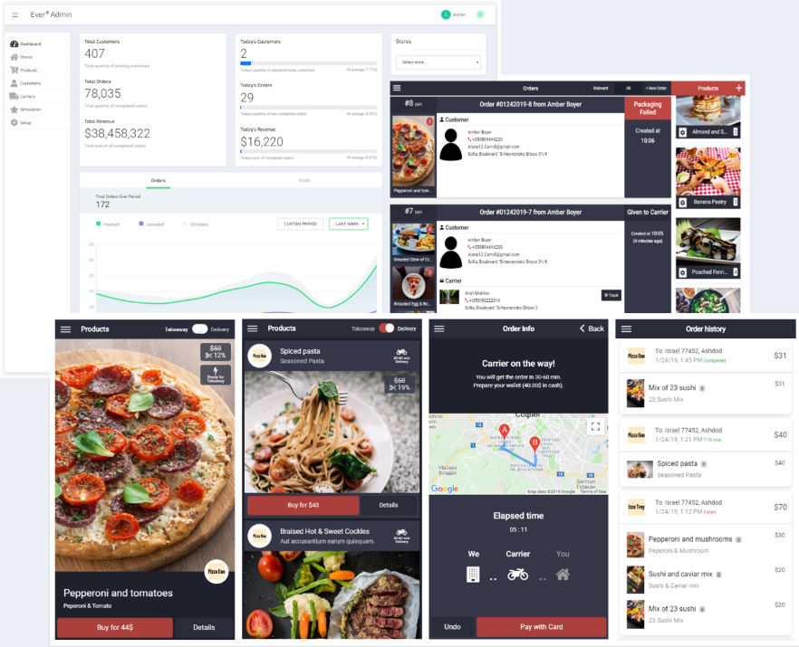

# Digital Market with Multiple Stores



- [Admin Website](http://localhost:4200), use admin email: `admin@emarket.com`, password: `admin`
- [Shopping Mobile App](http://localhost:4201)
- [Merchant Ionic Tablet App](http://localhost:4202), use merchant email: `merchant@emarket.com`, password: `123456`
- [Carrier Mobile App](http://localhost:4203)
- [Shopping Website](http://localhost:3000), use client email, generated randomly (can be found in admin panel): `xxx@xxx.com`, password: `123456`

## Features

- Supports single and multiple stores / multi-vendor market;
- Everything is reactive, real-time, and very fast;
- A headless commerce platform that allows implementing various stores, admin UIs, and client applications. Provides rich specific APIs for GraphQL, REST, and WS;
- Mobile shopping app for customers to place on-demand orders (Hybrid / PWA, iOS and Android using Ionic / Ionic Native);
- Carrier (driver) mobile app for delivery by carriers, drivers, or service providers (iOS and Android using Ionic / Ionic Native);
- Customizable e-commerce website for shopping, allowing customers to purchase goods or services in the browser;
- Merchant tablet app for stores/sellers/warehouses to manage and track orders, organize supplies, etc.;
- Admin website used to manage all platform functions and settings in a single web interface;
- Multilingual and cultural settings throughout the platform (i18N);
- Product catalogs (global and per-merchant) with multiple product images;
- Warehouse management and real-time order processing/handling on the platform;
- Supply/delivery management and processing on the platform (delivery with real-time order location tracking);
- Real-time discounts, promotions, and product/service availability updates;
- Customer registration, guest checkout, invitations (optional);
- Payment gateway and processing (not completed);
- Plugins/Extensions/Custom fields (WIP).

## Tech Stack and Requirements

- [TypeScript](https://www.typescriptlang.org);
- [NodeJs](https://nodejs.org) / [NestJs](https://github.com/nestjs/nest);
- [Ionic](https://ionicframework.com) (v5) for the shopping mobile app, carrier app, and merchant tablet app;
- Shopping website developed with [Angular](https://angular.io) (v9.1) using [Angular Starter](https://github.com/gdi2290/angular-starter);
- Admin website developed with [Angular](https://angular.io) (v9.1) using [ngx-admin](https://github.com/akveo/ngx-admin);
- Backend/Server developed with [Nest](https://github.com/nestjs/nest) using the Pyro module. Supports real-time GraphQL, REST, and WS APIs (WebSocket using the [Socket.io](https://socket.io) library);
- [RxJS](http://reactivex.io/rxjs) library, heavily used in all parts of the platform;
- [InversifyJS](http://inversify.io) used for inversion of control / dependency injection in most parts of the platform. The backend/API also uses DI provided by [Nest](https://github.com/nestjs/nest);
- [MongoDB](https://www.mongodb.com) Database, used with [Mongoose](https://mongoosejs.com) ORM (supported MongoDB version >= 3.2; recommended version >= 4). Data can be managed via [MongoDB Compass](https://www.mongodb.com/try/download/compass);
- For production, it is integrated and recommended to use [PM2](https://github.com/Unitech/pm2).

#### See also README.md and CREDITS.md files in the respective folders with lists of libraries and software included in the Platform, license information, and other details.

## Documentation

For a quick overview of each project on the Platform (Server, Admin, Stores, etc.), you can search for the README.md file in the project's root folder. For example, see [./core/README.md](packages/core/README.md) for an overview related to the server (backend).

## Getting Started

### Clone the Repository

Clone the Git repository:

```
git clone https://github.com/alvinahmadov/emarket.git
```

### Yarn

Currently, "Yarn" is used (instead of "npm"), so before running the platform, make sure you have the latest version of Yarn installed:

```
npm install -g yarn@latest
```

### Quick Install

After cloning the git repository, simply run the following command to install/bootstrap all dependencies:

```
yarn bootstrap
```

The above command installs the necessary packages in all platform projects using Lerna.

**Note**: If for any reason the above command fails, you can try to install the necessary packages manually by running "yarn" in each subdirectory of the "packages" folder with a "package.json" file.

### Build

You can build all projects using the single command below:

```
yarn build:all
```

**Note**: Parallel build is available using the `yarn build` command.

### Lerna (Manual Installation)

Lerna is used to manage monorepositories.

You need to execute the following command from the working folder where you cloned the git repository, which installs Lerna along with other packages:

```
yarn
```

Alternatively, you can install Lerna globally:

```
npm install lerna@latest -g
```

Now, after installing Lerna (locally or globally), you need to load all dependencies manually:

```
yarn lerna bootstrap
```

The above command installs all necessary packages for each subproject of the Platform.

**Note**: If for any reason the above command fails, you can try to install the necessary packages manually by running "yarn" in each subdirectory with a "package.json" file.

After loading Lerna, everything you need to start the build for all projects is described above in the '[Build](#Build)' section.

### MongoDB

The platform is configured to use MongoDB by default and assumes that the MongoDB service is running and accepting connections on localhost default:27017. Please see the [documentation](https://docs.mongodb.com/) for MongoDB.

### Running Platform Subprojects

Once you have built everything, each project can be started with a single command from this list:

- Run server `yarn run:server`
- Run admin site `yarn run:admin` and open http://localhost:4200
- Run shopping mobile app `yarn run:shopmobile` and open http://localhost:4201
- Run merchant app `yarn run:merchant` and open http://localhost:4202
- Run carrier mobile app `yarn run:carrier` and open http://localhost:4203
- Run website `yarn run:shopweb` and open http://localhost:3000

**Note 1**: It is important to pre-build shared platform modules (`yarn build:common` or `yarn build:all`) before running the platform (API) or apps.

**Note 2**: During development, you can start the server using "yarn run:server:dev" to enable watching for TS file changes.

**Note 3**: On the first run, the API server (backend) creates a local MongoDB database "ever_development" with the following (default) admin credentials:

- email: `admin@emarket.com`
- password: `admin`

You can use the above credentials to log in to the platform admin application.

**Note 4**: To be able to run each project, you need to make sure everything is built, see the '[Build](#Build)' section above.

## Security

In a production setup, all communication between client and server (backend, API) must be encrypted using HTTPS/WSS/SSL (REST API, GraphQL endpoint, Socket I/O websites, etc.).
